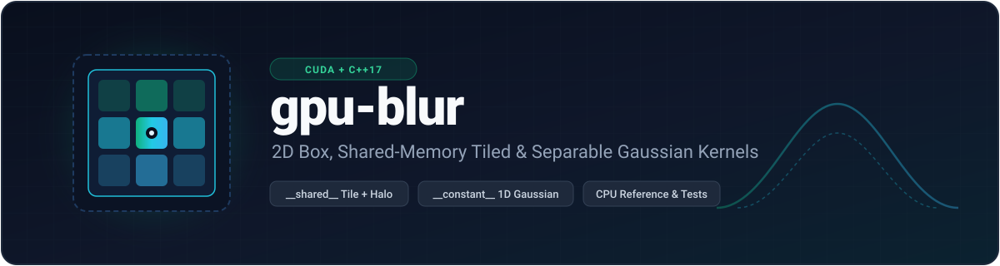
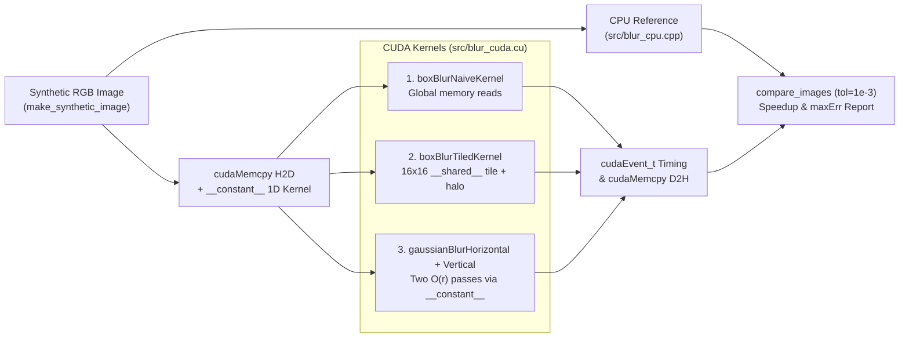

<div align="center">



[](include/blur_cpu.hpp)
[](src/blur_cuda.cu)
[](Makefile)
[](tests/test_blur_cpu.cpp)
[](https://github.com/aayushhzz/gpu-blur)

**CUDA 2D image blur kernels (naive box, shared-memory tiled box, and separable constant-memory Gaussian) paired with a portable C++17 CPU reference implementation and pixel-exact verification suite.**

[Architecture](#architecture) · [Kernels](#kernels) · [Quick Start](#quick-start) · [Usage](#usage) · [Project Structure](#project-structure) · [Deep Dive](docs/architecture.md)

</div>

---

## Overview

`gpu-blur` implements three progressive GPU image-filtering strategies in CUDA C++ alongside a dependency-free C++17 CPU reference so you can build, benchmark, and test on macOS/Linux without an NVIDIA GPU, then compile and verify GPU speedups on Linux or Google Colab with `nvcc`.

## Architecture



See [docs/architecture.md](docs/architecture.md) for memory layout, dynamic shared-memory sizing, clamp-to-edge semantics, and verification tolerances.

## Kernels

| Kernel | Source | Memory Strategy | Complexity |
|---|---|---|---|
| **Naive 2D Box Blur** (`boxBlurNaiveKernel`) | [src/blur_cuda.cu](src/blur_cuda.cu) | Direct global memory reads with `d_clamp` | `O((2r + 1)^2)` global reads/px |
| **Shared-Memory Tiled Box Blur** (`boxBlurTiledKernel`) | [src/blur_cuda.cu](src/blur_cuda.cu) | Cooperative `16×16` tile + `r`-pixel halo in dynamic `__shared__` memory per channel | Reduced global traffic via halo reuse |
| **Separable Gaussian Blur** (`gaussianBlurHorizontalKernel` + `gaussianBlurVerticalKernel`) | [src/blur_cuda.cu](src/blur_cuda.cu) | Normalized 1D weights in `__constant__ float d_gauss_kernel[65]` | Two `O(2r)` passes |
| **CPU Reference** (`box_blur_cpu`, `gaussian_blur_2d_cpu`, `gaussian_blur_separable_cpu`) | [src/blur_cpu.cpp](src/blur_cpu.cpp) | Portable C++17 clamp-to-edge reference + binary PPM (P6) I/O | Ground-truth verification |

## Quick Start

### CPU Reference & Tests (macOS / Linux)

No CUDA Toolkit required — compiles with `clang++` or `g++` via [Makefile](Makefile):

```bash
make test     # builds and runs all 8 CPU reference unit tests
make bench    # runs CPU benchmark (512x512 RGB, radius=5, sigma=2.0)
```

### CUDA Kernels (Linux / Google Colab with NVIDIA GPU)

```bash
make cuda
./build/step1_vecadd
./build/blur_cuda 1024 1024 5 2.0
```

Or compile directly with `nvcc`:

```bash
nvcc -O2 -std=c++17 -Iinclude src/blur_cuda.cu src/blur_cpu.cpp -o blur_cuda
./blur_cuda 1024 1024 5 2.0
```

## Usage

### CPU Benchmark & PPM Export

```bash
./build/blur_cpu_cli [width] [height] [radius] [sigma] [out_prefix]
# Example: writes /tmp/demo_src.ppm, /tmp/demo_box.ppm, /tmp/demo_gauss.ppm
./build/blur_cpu_cli 512 512 5 2.0 /tmp/demo
```

### CUDA Benchmark & Verification Harness

```bash
./build/blur_cuda [width] [height] [radius] [sigma]
```

`blur_cuda` (defaults: `1024 1024 5 2.0`, max radius `32`) times each GPU kernel with `cudaEvent_t`, compares every output pixel against `box_blur_cpu` / `gaussian_blur_separable_cpu` within `1e-3f`, prints speedup and `maxErr` / `mismatches`, and exits non-zero if any pixel exceeds tolerance.

## Project Structure

| Path | Description |
|---|---|
| [include/blur_cpu.hpp](include/blur_cpu.hpp) | `gpu_blur::Image`, CPU blur API, synthetic image generator, PPM I/O, comparison metrics |
| [src/blur_cpu.cpp](src/blur_cpu.cpp) | Box blur, direct 2D Gaussian, and separable 1D-pass Gaussian implementations |
| [src/blur_cuda.cu](src/blur_cuda.cu) | CUDA naive box, tiled shared-memory box, and separable Gaussian kernels + benchmark harness |
| [src/main_cpu.cpp](src/main_cpu.cpp) | Standalone CPU benchmark and optional PPM exporter CLI |
| [tests/test_blur_cpu.cpp](tests/test_blur_cpu.cpp) | 8 unit tests (kernel symmetry, radius-0 identity, corner clamping, separability, PPM round-trip) |
| [step1_vecadd.cu](step1_vecadd.cu) | Warmup 1D vector addition CUDA kernel |
| [Makefile](Makefile) | Targets: `all`, `cpu`, `test`, `bench`, `cuda`, `clean` |
| [docs/architecture.md](docs/architecture.md) | Kernel memory hierarchy, halo sizing, and verification details |

---

<div align="center">

Built by [@aayushhzz](https://github.com/aayushhzz) · [Report an Issue](https://github.com/aayushhzz/gpu-blur/issues)

</div>
